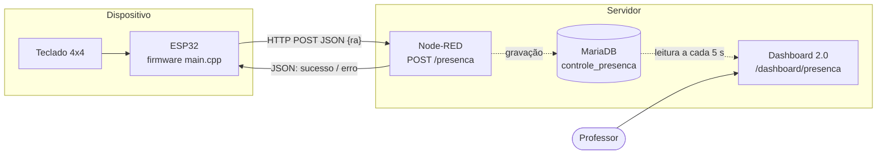
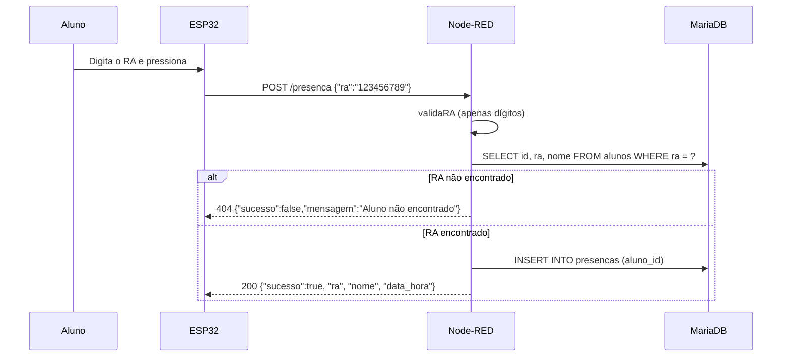
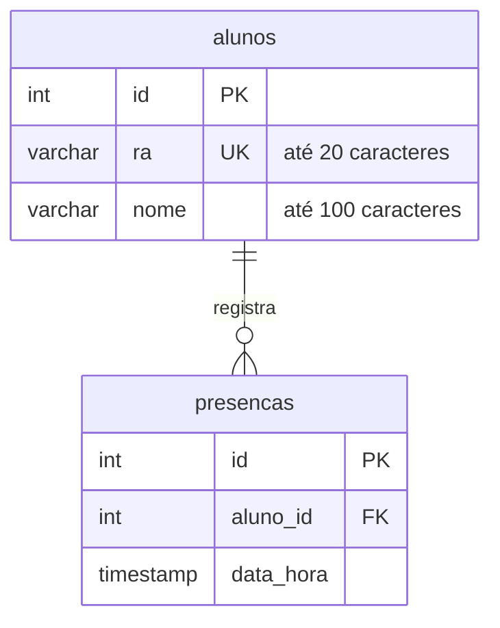

# 🏫 Controle de Presença — ESP32 + Node-RED + MariaDB

Sistema de controle de presença em sala de aula. O aluno digita o seu **RA** em um teclado matricial conectado a um **ESP32**; o equipamento envia o RA por HTTP a um fluxo **Node-RED**, que valida o aluno no **MariaDB/MySQL**, registra a presença e alimenta um **dashboard em tempo real**.

O firmware pode ser executado em um ESP32 físico ou simulado no **Wokwi**.

---

## 📑 Sumário

1. [Visão geral](#-1-visão-geral)
2. [Requisitos](#-2-requisitos)
3. [Tecnologias utilizadas](#-3-tecnologias-utilizadas)
4. [Arquitetura](#-4-arquitetura)
5. [Estrutura do repositório](#-5-estrutura-do-repositório)
6. [Pré-requisitos](#-6-pré-requisitos)
7. [Instalação e configuração](#-7-instalação-e-configuração)
8. [Execução](#-8-execução)
9. [API](#-9-api)
10. [Banco de dados](#-10-banco-de-dados)
11. [Variáveis de configuração](#-11-variáveis-de-configuração)
12. [Testes](#-12-testes)
13. [Deploy](#-13-deploy)
14. [Limitações conhecidas e melhorias](#-14-limitações-conhecidas-e-melhorias)

---

## 🎯 1. Visão geral

### Objetivo

Automatizar o registro de presença em sala de aula e permitir que o professor acompanhe, em tempo real, quem já chegou, quem ainda não chegou e qual é o percentual de presença da turma.

### Problema que resolve

A chamada manual consome tempo da aula, está sujeita a erros de anotação e não oferece uma visão imediata da frequência. Este projeto substitui a chamada por um registro eletrônico: cada aluno digita o RA e a informação aparece na hora em um painel, sem digitação posterior por parte do professor.

### Escopo

**Dentro do escopo**

- Entrada do RA por teclado matricial 4x4 conectado ao ESP32.
- Envio do RA via Wi-Fi para uma API HTTP implementada em Node-RED.
- Validação do RA e consulta do aluno no banco de dados.
- Registro de data e hora da presença.
- Dashboard web com métricas do dia e lista de presentes.
- Simulação do hardware no Wokwi.

**Fora do escopo (não implementado)**

- Cadastro de alunos pela interface (os alunos são inseridos diretamente no banco).
- Múltiplas turmas, disciplinas ou aulas por dia.
- Autenticação, HTTPS e perfis de usuário.
- Histórico por data, relatórios e exportação.
- Bloqueio de registros duplicados do mesmo aluno no mesmo dia.
- Identificação por RFID, biometria ou QR Code.

### Funcionalidades do dashboard

| Indicador | Descrição |
|---|---|
| Total Matriculados | Quantidade de alunos na tabela `alunos` |
| Presentes Hoje | Alunos distintos com ao menos um registro na data atual |
| Ausentes Hoje | Matriculados menos presentes |
| Última Entrada | Horário do registro mais recente |
| Percentual de Presentes | Gráfico circular com a taxa de presença |
| Lista de Presença | RA, nome e horário de cada aluno presente |

O painel é atualizado automaticamente a cada 5 segundos.

---

## ✅ 2. Requisitos

### 2.1 Requisitos funcionais

| ID | Requisito |
|---|---|
| RF01 | O sistema deve permitir digitar o RA do aluno em um teclado matricial 4x4. |
| RF02 | A tecla `#` deve confirmar o RA digitado e disparar o envio. |
| RF03 | A tecla `*` deve apagar o RA que está sendo digitado. |
| RF04 | O firmware deve enviar o RA em uma requisição `POST` com corpo JSON ao endpoint `/presenca`. |
| RF05 | O backend deve validar se o RA foi informado e se contém apenas dígitos. |
| RF06 | O backend deve consultar se existe aluno com o RA informado. |
| RF07 | Se o aluno existir, o backend deve registrar a presença na tabela `presencas`. |
| RF08 | O backend deve responder em JSON com o resultado (`sucesso`, `mensagem` e, quando aplicável, `ra`, `nome`, `data_hora`). |
| RF09 | O dashboard deve exibir total de matriculados, presentes, ausentes e hora da última entrada. |
| RF10 | O dashboard deve exibir o percentual de presença em gráfico. |
| RF11 | O dashboard deve listar os alunos presentes no dia, do registro mais recente para o mais antigo. |
| RF12 | O dashboard deve se atualizar automaticamente, sem ação do usuário. |
| RF13 | O firmware deve informar o andamento (digitação, envio, código HTTP, erros) pelo monitor serial. |

### 2.2 Requisitos não funcionais

| ID | Categoria | Requisito | Situação |
|---|---|---|---|
| RNF01 | Desempenho | O painel deve refletir novos registros em até ~5 s. | ✅ Atendido (polling de 5 s) |
| RNF02 | Usabilidade | O registro deve exigir apenas digitar o RA e pressionar `#`. | ✅ Atendido |
| RNF03 | Portabilidade | O firmware deve funcionar em ESP32 real e no simulador Wokwi. | ✅ Atendido |
| RNF04 | Interoperabilidade | A comunicação deve usar HTTP e JSON. | ✅ Atendido |
| RNF05 | Manutenibilidade | Código-fonte, circuito e fluxo devem ficar versionados no repositório. | ✅ Atendido |
| RNF06 | Compatibilidade | O banco deve ser MySQL/MariaDB com `utf8mb4`. | ✅ Atendido |
| RNF07 | Segurança | A entrada do usuário deve ser validada antes de compor consultas SQL. | ⚠️ Parcial (validação numérica por regex; sem consultas parametrizadas) |
| RNF08 | Segurança | A API e o dashboard devem exigir autenticação e HTTPS. | ❌ Não implementado |
| RNF09 | Confiabilidade | O firmware deve tratar falha de Wi-Fi e erro HTTP. | ⚠️ Parcial (informa o erro, mas não reenvia nem reconecta) |

---

## 🛠️ 3. Tecnologias utilizadas

| Camada | Tecnologia | Uso no projeto |
|---|---|---|
| Hardware | [ESP32](https://www.espressif.com/en/products/socs/esp32) (`esp32dev`) | Microcontrolador com Wi-Fi |
| Hardware | Teclado de membrana 4x4 | Entrada do RA |
| Firmware | C++ / [Arduino framework](https://docs.platformio.org/en/latest/frameworks/arduino.html) | Lógica do dispositivo |
| Firmware | Bibliotecas `WiFi`, `HTTPClient` (nativas do core ESP32) e [`Keypad`](https://github.com/Chris--A/Keypad) `^3.1.1` | Rede, HTTP e leitura do teclado |
| Build | [PlatformIO](https://platformio.org/) | Compilação, dependências, upload |
| Simulação | [Wokwi](https://wokwi.com/) | Simulação do circuito e do firmware |
| Backend | [Node-RED](https://nodered.org/) | API HTTP e regras de negócio |
| Backend | `node-red-node-mysql` 3.0.3 | Acesso ao banco |
| Frontend | `@flowfuse/node-red-dashboard` 1.30.2 (Dashboard 2.0, Vue) | Painel web |
| Dados | MariaDB 10.4+ / MySQL | Persistência (`alunos`, `presencas`) |

---

## 🏗️ 4. Arquitetura

A aplicação tem três blocos: **dispositivo** (ESP32), **backend/frontend** (Node-RED) e **dados** (MariaDB).



### Fluxo de registro de presença



### Principais componentes

**Firmware — `src/main.cpp`**

| Elemento | Função |
|---|---|
| `setup()` | Inicializa a serial e conecta ao Wi-Fi |
| `loop()` | Lê o teclado e acumula os dígitos em `raAcumulado`; `#` envia, `*` apaga |
| `enviarPresenca(ra)` | Monta o JSON e executa o `POST`; imprime o código HTTP na serial |

**Node-RED — `ndred/flows.json`** (aba única, 22 nós)

| Grupo | Nós | Função |
|---|---|---|
| API de registro | `http in` (`POST /presenca`) → `json` → `validaRA` → `mysql` → `switch` → `erro` / `sucesso` → `mysql` → `function 1` → `http response` | Valida o RA, consulta o aluno, grava a presença e responde |
| Atualização do painel | `inject` (a cada 5 s) → `function 2` → `mysql` → `function 3` → `ui-template` | Consulta os presentes do dia, calcula métricas e renderiza o dashboard |
| Configuração | `MySQLdatabase`, `ui-base`, `ui-page`, `ui-theme`, `global-config` | Conexão com o banco e configuração do Dashboard |

**Circuito — `diagram.json`**

| Teclado | Linhas R1–R4 | Colunas C1–C4 |
|---|---|---|
| GPIO do ESP32 | 19, 18, 5, 17 | 16, 4, 2, 15 |

---

## 📂 5. Estrutura do repositório

```
Controle-De-Presenca/
├── src/
│   └── main.cpp            # Firmware do ESP32
├── ndred/
│   └── flows.json          # Fluxo do Node-RED (API + dashboard)
├── database/
│   └── alunos.sql          # Dump da tabela `alunos` com dados de exemplo
├── diagram.json            # Circuito do Wokwi (ESP32 + teclado 4x4)
├── wokwi.toml              # Configuração do simulador (aponta para o firmware compilado)
├── platformio.ini          # Configuração do PlatformIO (placa, framework, bibliotecas)
├── include/  lib/  test/   # Pastas padrão do PlatformIO (somente README, sem código)
├── .gitignore
└── README.md
```

---

## 📋 6. Pré-requisitos

| Item | Versão / observação |
|---|---|
| [Node.js](https://nodejs.org/) | LTS 18 ou superior (necessário para o Node-RED) |
| [Node-RED](https://nodered.org/docs/getting-started/) | Versão atual |
| MariaDB ou MySQL | MariaDB 10.4+ (o dump foi gerado na 10.4.32) |
| [VS Code](https://code.visualstudio.com/) + extensão [PlatformIO IDE](https://platformio.org/install/ide?install=vscode) | Para compilar o firmware |
| Extensão [Wokwi para VS Code](https://docs.wokwi.com/vscode/getting-started) | Para simular (exige licença Wokwi; há opção gratuita) |
| ESP32 DevKit + teclado 4x4 | Opcional, apenas para uso em hardware real |
| Git | Para clonar o repositório |

---

## ⚙️ 7. Instalação e configuração

### 7.1 Clonar o repositório

```bash
git clone https://github.com/GMaruccio/Controle-De-Presenca.git
cd Controle-De-Presenca
```

### 7.2 Banco de dados

O arquivo `database/alunos.sql` cria somente a tabela `alunos`, sem `CREATE DATABASE`. Além disso, **o fluxo grava na tabela `presencas`, que não está no dump** e precisa ser criada manualmente (ver [seção 10](#-10-banco-de-dados)).

```bash
# 1) Criar o banco
mysql -u root -p -e "CREATE DATABASE controle_presenca CHARACTER SET utf8mb4 COLLATE utf8mb4_general_ci;"

# 2) Importar a tabela de alunos
mysql -u root -p controle_presenca < database/alunos.sql

# 3) Criar a tabela de presenças
mysql -u root -p controle_presenca -e "
CREATE TABLE presencas (
  id        INT(11)   NOT NULL AUTO_INCREMENT PRIMARY KEY,
  aluno_id  INT(11)   NOT NULL,
  data_hora TIMESTAMP NOT NULL DEFAULT CURRENT_TIMESTAMP,
  KEY idx_data_hora (data_hora),
  CONSTRAINT fk_presencas_aluno FOREIGN KEY (aluno_id) REFERENCES alunos(id)
) ENGINE=InnoDB DEFAULT CHARSET=utf8mb4;"
```

Opcionalmente, crie um usuário dedicado (recomendado em vez de usar `root`):

```sql
CREATE USER 'presenca'@'localhost' IDENTIFIED BY 'TROQUE_ESTA_SENHA';
GRANT SELECT ON controle_presenca.alunos     TO 'presenca'@'localhost';
GRANT SELECT, INSERT ON controle_presenca.presencas TO 'presenca'@'localhost';
```

### 7.3 Node-RED

1. Instale o Node-RED, caso ainda não tenha:

   ```bash
   npm install -g --unsafe-perm node-red
   ```

2. Instale as paletas usadas pelo fluxo (versões declaradas no `flows.json`):

   ```bash
   cd ~/.node-red
   npm install node-red-node-mysql@3.0.3 @flowfuse/node-red-dashboard@1.30.2
   ```

3. Inicie o Node-RED (`node-red`) e abra `http://localhost:1880`.
4. Menu ☰ → **Import** → selecione `ndred/flows.json` → **Import**.
5. Dê um duplo clique em qualquer nó **mysql** → edite o servidor `controle_presenca` e informe **usuário e senha** do banco. Host (`127.0.0.1`), porta (`3306`) e base (`controle_presenca`) já vêm configurados; as credenciais não são versionadas.
6. Clique em **Deploy**.

### 7.4 Firmware (ESP32)

Edite `src/main.cpp` e ajuste:

```cpp
const char* ssid     = "Wokwi-GUEST";   // Rede Wi-Fi (no Wokwi, mantenha Wokwi-GUEST)
const char* password = "";              // Senha da rede
const char* serverName = "http://192.168.15.14:1880/presenca";  // IP da máquina com o Node-RED
```

> ⚠️ `192.168.15.14` é o IP da máquina do autor. **Troque pelo IPv4 do computador onde o Node-RED está rodando** (`ipconfig` no Windows, `ip a` no Linux/macOS).

Em ESP32 físico, use o SSID e a senha da sua rede; o computador e o ESP32 devem estar na mesma rede.

---

## ▶️ 8. Execução

### 8.1 Subir o backend

1. Inicie o MariaDB/MySQL.
2. Inicie o Node-RED (`node-red`) e confirme que o fluxo está implantado (Deploy).
3. Acesse o dashboard: **`http://localhost:1880/dashboard/presenca`**.

### 8.2 Compilar o firmware

```bash
pio run
```

Isso gera `.pio/build/esp32dev/firmware.bin` e `firmware.elf`, que são os arquivos que o `wokwi.toml` espera.

### 8.3 Opção A — Simulação no Wokwi

1. Compile o firmware (`pio run`).
2. No VS Code, abra o `diagram.json` e execute **Wokwi: Start Simulator** (F1).
3. Abra o monitor serial e digite o RA no teclado virtual; confirme com `#`.

> O ESP32 simulado acessa a rede `Wokwi-GUEST`. Para alcançar um Node-RED rodando no seu computador, é preciso habilitar o [Wokwi IoT Gateway](https://docs.wokwi.com/guides/esp32-wifi) (consulte a documentação do Wokwi para os requisitos do seu plano). Sem ele, a conexão com o IP local não é estabelecida.

### 8.4 Opção B — ESP32 físico

1. Monte o circuito conforme a tabela da [seção 4](#circuito--diagramjson).
2. Conecte a placa por USB e execute:

   ```bash
   pio run -t upload
   pio device monitor      # 115200 baud
   ```

### 8.5 Uso do teclado

| Tecla | Ação |
|---|---|
| `0`–`9` | Acumula dígitos do RA |
| `#` | Confirma e envia o RA |
| `*` | Apaga o RA digitado |
| `A`–`D` | Também são acumuladas, mas o servidor rejeita RA com letras (use apenas dígitos) |

---

## 🔌 9. API

A única rota de entrada de dados é exposta pelo próprio Node-RED.

### `POST /presenca`

Registra a presença de um aluno.

- **URL:** `http://<ip-do-servidor>:1880/presenca`
- **Header:** `Content-Type: application/json`
- **Corpo:**

  ```json
  { "ra": "123456789" }
  ```

**Respostas**

| Status | Situação | Corpo |
|---|---|---|
| `200` | Presença registrada | `{"sucesso":true,"mensagem":"Presença registrada","ra":"123456789","nome":"João Silva","data_hora":"2026-11-18T14:30:00.000Z"}` |
| `404` | RA não cadastrado | `{"sucesso":false,"mensagem":"Aluno não encontrado"}` |
| `400` | RA ausente ou inválido | `{"sucesso":false,"mensagem":"RA não informado"}` ou `{"sucesso":false,"mensagem":"RA inválido"}` — ver [limitação](#-14-limitações-conhecidas-e-melhorias) |

> O campo `data_hora` da resposta é gerado pelo Node-RED em UTC (ISO 8601). O horário gravado no banco é gerado pelo servidor de banco de dados.

**Exemplo**

```bash
curl -X POST http://localhost:1880/presenca \
  -H "Content-Type: application/json" \
  -d '{"ra":"123456789"}'
```

### Dashboard

| Rota | Descrição |
|---|---|
| `GET /dashboard/presenca` | Painel de frequência (Dashboard 2.0) |

---

## 🗄️ 10. Banco de dados

- **SGBD:** MariaDB 10.4+ / MySQL
- **Banco:** `controle_presenca`
- **Charset:** `utf8mb4`
- **Conexão:** `127.0.0.1:3306` (definida no nó de configuração `MySQLdatabase` do Node-RED)

### Modelo



### Tabela `alunos` (em `database/alunos.sql`)

| Coluna | Tipo | Restrições |
|---|---|---|
| `id` | `int(11)` | PK, AUTO_INCREMENT |
| `ra` | `varchar(20)` | NOT NULL, UNIQUE |
| `nome` | `varchar(100)` | NOT NULL |

O dump traz 23 alunos de exemplo (RAs como `123456789`, `987654321`, `111222333`...).

### Tabela `presencas` (não incluída no repositório)

O fluxo executa `INSERT INTO presencas (aluno_id)` e lê `presencas.aluno_id` e `presencas.data_hora`, então a tabela precisa ter ao menos essas colunas. O script da [seção 7.2](#72-banco-de-dados) foi **deduzido a partir do uso no fluxo**; ajuste conforme necessário. A coluna `data_hora` precisa ter valor padrão `CURRENT_TIMESTAMP`, pois o `INSERT` não informa a data.

### Consultas utilizadas pelo sistema

```sql
-- Validação do RA (API)
SELECT id, ra, nome FROM alunos WHERE ra = '<ra>' LIMIT 1;

-- Registro de presença (API)
INSERT INTO presencas (aluno_id) VALUES (<id>);

-- Dados do dashboard (a cada 5 s)
SELECT a.ra, a.nome, MAX(p.data_hora) AS ultima_hora_registro,
       (SELECT COUNT(id) FROM alunos) AS total_matriculados
FROM presencas p
JOIN alunos a ON p.aluno_id = a.id
WHERE DATE(p.data_hora) = CURRENT_DATE
GROUP BY a.ra, a.nome
ORDER BY ultima_hora_registro DESC;
```

> Se um aluno registrar mais de uma vez no dia, o dashboard o conta **uma única vez**, exibindo o horário do último registro.

---

## 🔐 11. Variáveis de configuração

O projeto **não usa arquivos `.env`**: os parâmetros ficam no código ou na configuração do Node-RED.

| Parâmetro | Onde está | Valor atual | Descrição |
|---|---|---|---|
| `ssid` | `src/main.cpp` | `Wokwi-GUEST` | Nome da rede Wi-Fi |
| `password` | `src/main.cpp` | `""` | Senha do Wi-Fi |
| `serverName` | `src/main.cpp` | `http://192.168.15.14:1880/presenca` | URL da API do Node-RED |
| `rowPins` / `colPins` | `src/main.cpp` e `diagram.json` | `19,18,5,17` / `16,4,2,15` | Pinos do teclado |
| `monitor_speed` | `platformio.ini` | `115200` | Velocidade do monitor serial |
| Host / porta / base do MySQL | Nó `MySQLdatabase` | `127.0.0.1` / `3306` / `controle_presenca` | Conexão com o banco |
| Usuário e senha do MySQL | Nó `MySQLdatabase` (credenciais do Node-RED) | — | **Não versionados** (ficam em `flows_cred.json`, em `~/.node-red`) |
| Intervalo de atualização | Nó `inject` | `5` s | Frequência de atualização do dashboard |
| Porta do Node-RED | `~/.node-red/settings.js` | `1880` | Porta HTTP |

> 🔒 **Segurança:** não versione senhas de Wi-Fi nem do banco. Antes de publicar uma versão com credenciais reais no `main.cpp`, mova-as para um arquivo ignorado pelo Git.

---

## 🧪 12. Testes

O repositório **não possui testes automatizados** (a pasta `test/` contém apenas o README padrão do PlatformIO). Os procedimentos abaixo são **testes manuais**.

### 12.1 Testar a API sem o ESP32

Com o Node-RED e o banco ativos:

| # | Teste | Comando | Resultado esperado |
|---|---|---|---|
| 1 | RA válido | `curl -i -X POST localhost:1880/presenca -H "Content-Type: application/json" -d '{"ra":"123456789"}'` | `200` com nome *João Silva* |
| 2 | RA inexistente | `curl -i -X POST localhost:1880/presenca -H "Content-Type: application/json" -d '{"ra":"000000001"}'` | `404` "Aluno não encontrado" |
| 3 | Registro no banco | `SELECT * FROM presencas ORDER BY id DESC LIMIT 5;` | Nova linha com `aluno_id = 1` |
| 4 | Dashboard | Abrir `/dashboard/presenca` | "Presentes Hoje" incrementa em até 5 s |

> Para RA com letras ou ausente, veja a limitação da [seção 14](#-14-limitações-conhecidas-e-melhorias): o fluxo não devolve resposta ao cliente nesses casos.

### 12.2 Testar o firmware (Wokwi ou ESP32)

1. Digitar `123456789` e `#` → monitor serial exibe `[Sucesso] Código HTTP: 200`.
2. Digitar `000000001` e `#` → `[Sucesso] Código HTTP: 404` (o firmware chama de "Sucesso" qualquer código positivo).
3. Pressionar `#` sem digitar → "Nenhum RA digitado!".
4. Digitar dígitos e `*` → "RA Apagado".
5. Derrubar o Node-RED e enviar um RA → código HTTP negativo (`[Erro]`).

### 12.3 Testes unitários do firmware (opcional)

O PlatformIO oferece o Test Runner (`pio test`) para testes na pasta `test/`. Hoje ela está vazia.

---

## 🚀 13. Deploy

Não há pipeline de CI/CD nem contêineres neste repositório. O procedimento abaixo é uma **recomendação** para colocar o sistema em uso.

### 13.1 Servidor (Node-RED + banco)

1. Provisione uma máquina (ou VM) com Node.js LTS, Node-RED e MariaDB.
2. Crie o banco, o usuário dedicado e as tabelas (seção 7.2).
3. Importe o `flows.json`, configure as credenciais do MySQL e faça o Deploy.
4. Execute o Node-RED como serviço, por exemplo com PM2:

   ```bash
   npm install -g pm2
   pm2 start $(which node-red) -- -v
   pm2 save && pm2 startup
   ```

5. Proteja o ambiente: habilite `adminAuth` no `settings.js`, coloque um proxy reverso com HTTPS (Nginx/Caddy) e restrinja a porta 1880 por firewall à rede da sala.
6. Faça backup periódico do banco (`mysqldump controle_presenca`) e de `~/.node-red`.

### 13.2 Dispositivo

1. Ajuste `ssid`, `password` e `serverName` no `main.cpp` para a rede e o servidor de produção. Prefira um IP fixo ou nome de host para o servidor.
2. Grave o firmware: `pio run -t upload`.
3. Valide pelo monitor serial (`pio device monitor`) com um RA de teste.

---

## ⚠️ 14. Limitações conhecidas e melhorias

Pontos identificados na análise do código:

| # | Observação | Sugestão |
|---|---|---|
| 1 | O script `database/alunos.sql` não cria a tabela `presencas`, necessária ao funcionamento. | Versionar um `database/presencas.sql` (ou um script único `schema.sql`). |
| 2 | O ramo de erro do nó `validaRA` (HTTP 400) está ligado ao nó `mysql` em vez de ao `http response`. Com RA ausente ou inválido, a resposta 400 não chega ao ESP32. O nó `json` também pode falhar sem responder para valores que não são JSON válido (por exemplo, RA com letras ou zeros à esquerda). | Adicionar um `switch` após `validaRA` direcionando erros ao `http response`; tratar o corpo sem o nó `json`. |
| 3 | A consulta é montada por concatenação de texto. Hoje a regex `^[0-9]+$` evita injeção de SQL, mas a proteção depende só dela. | Usar consultas parametrizadas (`msg.payload` com `?` no nó `mysql`). |
| 4 | O mesmo aluno pode ser registrado várias vezes no dia (o dashboard conta uma vez). | Impedir duplicidade por aluno/dia ou criar um índice único adequado. |
| 5 | `data_hora` da resposta (UTC, gerada pelo Node-RED) pode divergir do horário gravado pelo banco e do horário exibido no dashboard. | Padronizar o fuso horário (aplicação, banco e dashboard). |
| 6 | O firmware não reconecta o Wi-Fi após `setup()`, trata qualquer código HTTP > 0 como "Sucesso" e aceita `A`–`D` no RA. | Reconectar em `loop()`, interpretar o código/JSON da resposta, ignorar `A`–`D` e dar feedback com LED/buzzer/display. |
| 7 | Os GPIO 2 e 15 são pinos de *strapping* do ESP32 e podem interferir na inicialização em hardware real. | Avaliar outros pinos para as colunas do teclado. |
| 8 | A API não tem autenticação e usa HTTP simples; credenciais e IP estão no código. | Token na API, HTTPS e configuração fora do código. |
| 9 | Não há testes automatizados. | Criar testes de integração da API e testes no PlatformIO. |
| 10 | A pasta do fluxo se chama `ndred` (provável erro de digitação de `nodered`). | Renomear, atualizando as referências. |

---

## 👤 Autor

**Giovanni Maruccio** — [@GMaruccio](https://github.com/GMaruccio)
